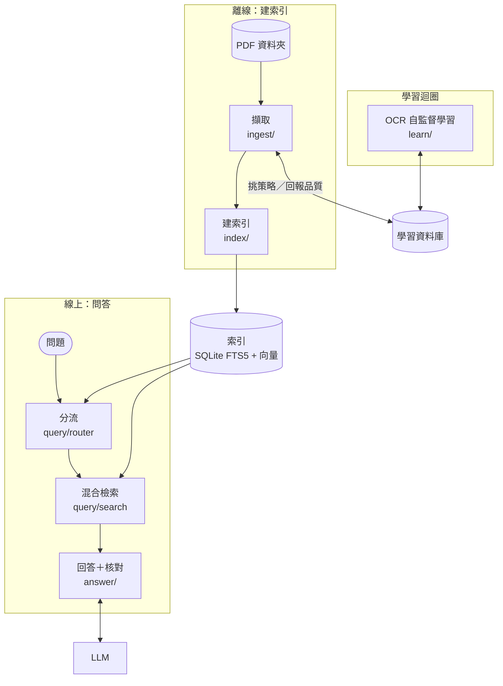
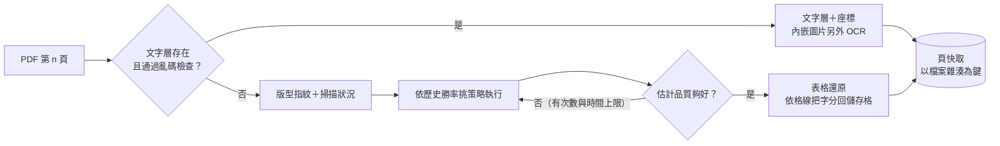
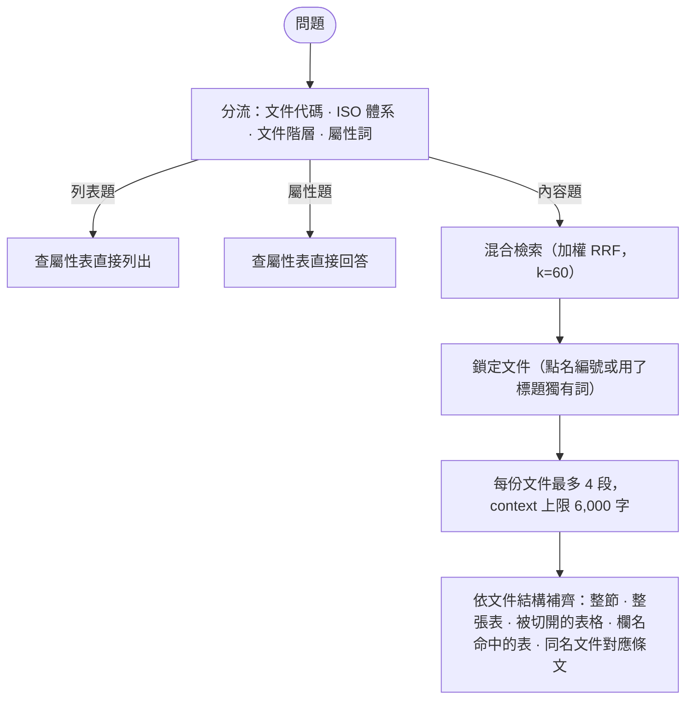
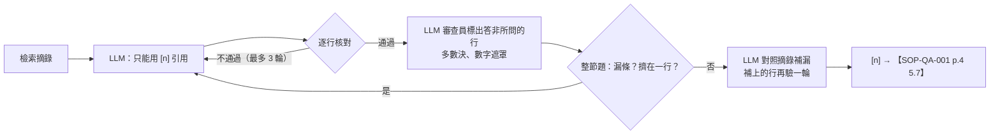

# ISO-RAG — ISO 文件問答與自適應 OCR

> **一句話介紹**：問公司 ISO 程序文件裡的規定，它從大量掃描 PDF 中找出原文來回答，每一行都標出「哪份文件、第幾頁、哪一條」，而且出處由程式產生、逐行核對過。

**系統導覽**：[Agent Hub（主入口）](https://github.com/LiN3simver/Agent_Hub_RAG_Frontend) · [Part-RAG](https://github.com/LiN3simver/Part-RAG) · [RFQ-RAG](https://github.com/LiN3simver/RFQ-RAG) · [BOM-RAG](https://github.com/LiN3simver/Bom-RAG) · [8D-Report-RAG](https://github.com/LiN3simver/8D-Report-RAG) · **ISO-RAG**

> 🚧 **開發中，並非完成品**：本專案仍在持續開發與調校，功能、介面與檢索／驗證策略都可能變動；文中的做法與數據反映目前階段，尚未經過正式上線驗證。

> **作品集展示版**：不含任何文件資料、索引、模型與設定，也未收錄接上 Agent Hub 的 A2A 包裝層。文中文件編號（如 `SOP-QA-001`）為虛構示意。

---

## 專案概覽

ISO 體系文件（程序書、管理辦法、表單）有大量掃描頁、表格、紅色受控章與內嵌流程圖，直接抽文字常常是空白或亂碼。這個專案把 PDF 轉成可檢索的條文段落，以混合檢索找出相關段落交給 LLM 回答，並讓 OCR 透過**自監督學習**越用越準。全程只用 CPU。

| 問法（範例） | 系統做什麼 |
|---|---|
| 「留樣品要保存多久？」 | 混合檢索 → LLM 回答 → 逐行核對 → 標出【文件 頁碼 條文】 |
| 「三階管理辦法有哪些？」 | 列表題：直接查文件屬性表，不呼叫 LLM |
| 「SOP-QA-001 的生效日期？」 | 屬性題：直接查屬性表回答 |
| 「哪些文件提到 X？」 | 全文核對整個語料，把完整清單當證據附給 LLM |

## 核心功能

- **每一頁都查得到**：文字層、掃描頁 OCR、表格還原、內嵌圖片另外 OCR
- **自適應 OCR**：依版型與掃描狀況挑選策略，品質不夠就換，並記住每種版型的最佳策略
- **出處不可偽造**：LLM 只寫 `[n]`，程式換成【文件 頁碼 條文】，頁碼與條號只標這一行實際用到的
- **答案不漏**：問整個章節、整張長表、被切開的表格時，依文件結構把缺的段落補齊；長表分段平行篩選再合併
- **多層自我驗證**：程式逐行核對原文 → LLM 審查員多數決 → 程式核對漏條 → LLM 補漏後再驗一輪
- **安全上線**：新索引寫完才原子切換；新 OCR 模型通過評測閘門才能啟用、可隨時退回

## 系統架構

三條路只透過檔案（頁快取、索引、學習資料庫）交換資料，彼此不直接呼叫。



| 模組 | 負責 | 主要技術 |
|---|---|---|
| `ingest/` | PDF → 每頁文字 → 條文段落 | pypdfium2 文字層、RapidOCR、OpenCV 格線偵測 |
| `index/` | 段落 → 向量＋全文索引 | bge-m3（ONNX，CPU）、SQLite FTS5、OpenCC 繁簡正規化 |
| `query/` | 題型分流、鎖定文件、混合檢索 | 規則式分流、加權 RRF |
| `answer/` | 組答案、換引用、逐行核對 | LLM（Anthropic Messages API 相容）＋程式核對 |
| `learn/` | OCR 品質估計、策略選擇、訓練與評測 | 字元語言模型、嶺迴歸、kNN、勝率排序 |

### 擷取：PDF → 每頁文字



- **文字層也要驗**：字型編碼壞掉時文字層看起來有字、其實是亂碼；以規則（`(cid:`、亂碼比例、有效字比例）加上字元語言模型判斷，不像正常文件就改走 OCR
- **選項控件還原**：電子表單截圖的 ◉○■□ 常被 OCR 吞掉（「◉新增 ○修改」變成「新增修改」），以幾何形狀（外框填滿率、中心墨水、成組出現）偵測後補回文字，拆開被合併的詞框
- **六種策略**：預設、放寬偵測、銳化、對比拉伸、放大＋銳化、只取紅色通道（紅色受控章在紅色通道接近白紙，等於把章拿掉）
- **不需標準答案就能估品質**：OCR 信心、亂碼比例、語言模型分數，以及「影像上有墨跡但沒被框到」的比例——漏字時 OCR 信心照樣很高，只能靠這個抓
- **快取可續跑**：逐頁快取、原子寫入；人工校正另存、讀取時套用，原始結果不改寫

## 檢索流程



**建索引**：以整批文件學出頁首頁尾樣板（數字遮罩後在多數頁重複的行）並移除；依條文編號（`1.`、`5.1.1`、`1.0`、`一、`、`第一章`）切段，目標每段 120～700 字，記錄起訖頁與章節；表格類文件改逐頁切段。每段前綴「文件編號 名稱｜章節」，每份文件另有一張屬性卡（編號、版本、生效日期…）。

**檢索通道**：

| 通道 | 權重 | 啟用條件 | 擅長 |
|---|---|---|---|
| `bm25`（FTS5，中文雙字組＋英數 token） | 1.0 | 一律 | 用詞與原文相同 |
| `dense`（bge-m3，段落＋條文 MaxSim） | 1.0 | 一律 | 用詞不同、意思相同 |
| `code` | 2.0 | 問題點名文件編號 | 直接指定文件 |
| `phrase` | 2.0 | 與原文逐字相符 ≥ 8 字 | 貼上表單名稱、條文原句 |
| `scope_bm25` / `scope_dense` | 0.75 | 提到 ISO 體系或文件階層 | 限定範圍內再查一次 |

- **條文級多向量（MaxSim）**：段落向量會把一條短條文跟同段其他條文平均掉；每條條文另存一個向量，段落分數取兩者最大值，換句話問也找得到那一條
- **各路冠軍保送**：RRF 只看名次，只有一路排第 1 的段落會輸給兩路都中段的段落；每一路的第 1 名一定排進最後的前幾名
- **依結構補齊**：問題問整個章節（「…的定義是？」）就補齊整節；點名整張表就放整張表，長表交給分段篩選；表格被切在段落邊界時把接續段補上。全由文件的標題與表格結構決定，不看問法
- **同名文件並列**：不同單位各有一份同名文件時，檢索到一份就把另一份的對應條文接上，讓答案分文件列出
- **屬性與 PDF 自我核對**：屬性題的欄位（「版次」）在 PDF 裡也有、值卻對不上時，改交給檢索＋LLM，以 PDF 為準
- **能查表就不問 LLM**：列表題、屬性題直接從屬性表組答案，快、也不會編造
- **紙本編號對回文件**：紙本上印的編號從檔名與頁面文字建對照，分三級證據
- **向量檢索不需 ANN 索引**：千段規模以 numpy 內積暴力搜尋即可，低於 5 ms

## 驗證機制



- **逐行核對**：每一行的數字、代碼、英文字都必須出現在它引用的那段摘錄；從別段搬來的詞、職稱配錯人名也會被抓出
- **OCR 錯字容忍**：LLM 把 OCR 錯字改正時，以字元語言模型判斷合理後不扣分
- **全文核對**：問題引用原文或用了罕見詞時，比對全部文件產生完整清單——檢索前幾名一定列不完整
- **拼湊的代碼也抓得到**：字母數字混合的詞（版次 `A0`）要在原文整個出現，LLM 把兩欄拼成一個值時會被擋下
- **審查員多數決＋數字遮罩**：審查員只判斷切不切題；回答裡的數值遮成 `#`，避免它拿模型自己「記得」的數字否定正確答案。前兩票不一致才投第三票
- **只複述標頭的行**：「SOP-QA-009：未發行」這種沒有內容的行由程式偵測，審查員看不出來
- **補漏**：驗證通過後請 LLM 對照摘錄找漏掉的；補上的行以「對到原文的哪個位置」判斷是不是重複，再走一輪完整驗證
- **溫度 0**：回答、重寫、補漏用 temperature 0，同一題每次一樣；審查員保留取樣，讓多數決的票彼此獨立
- **核對不過不硬給**：仍不通過的行標註「核對不到原文」；每行都核對得到原文時，不因審查員否決就改說「文件未規定」

## Agent 協作

| 項目 | 內容 |
|---|---|
| Agent ID | `iso`（Hub registry，:8800） |
| 上游／下游 | 無——獨立節點，不呼叫別人、也不被委派 |
| 接入方式 | 經 A2A 包裝層接上 Agent Hub（本展示版未收錄）；`answer.prepare()`（不經 LLM）與 `answer.generate()` 是包裝層使用的介面 |
| 引用卡片 | 回答完成後，Hub 向 ISO 取「實際被引用的頁面」取代原本的檢索卡片，畫面只留答案用到的出處 |
| 預先查詢 tags | `ISO`、`SOP`、`管理辦法`、`作業規範` |

## 技術重點

| 挑戰 | 做法 |
|---|---|
| 沒有 OCR 標準答案 | **自監督**：把有文字層的頁渲染成影像，加上模糊、褪色、紅章、歪斜等 7 種劣化再 OCR，得到大量「影像 → 正確文字」樣本 |
| 新模型可能比舊的差 | **評測閘門**：以留一文件交叉驗證比對啟發式基準，策略選擇誤差、品質相關性、亂碼偵測率等都要達標，才允許手動 `promote`；可 `rollback` |
| 人工校正成本高 | 只把品質低、新版型、疑似漏字的頁排進待確認清單；校正結果同時修正內容並成為訓練資料 |
| 掃描狀況影響策略 | 以紅章比例、墨跡、對比、清晰度、歪斜等 8 個特徵，用 kNN 預測各策略的增益 |
| 表格逐行 OCR 會串欄 | OpenCV 找格線（先以 Hough 校正歪斜），把字依位置分回儲存格，同列以 `\|` 串起 |
| 長表一次交給 LLM 只挑出幾列 | 表格切成小段平行篩選，每段各自走完整驗證，再依表格順序合併、去重 |
| 修訂履歷的版次被當成條號 | 表格列有日期格就不是條文標題；OCR 版面順序錯亂時允許從第 1 章重新起頭 |
| 建索引中途失敗 | 每次建置寫成新 SQLite 檔，成功才切換 `CURRENT`；失敗就刪掉半成品 |

## 量化成果

| 指標 | 數值 |
|---|---|
| OCR 正確率（模擬掃描劣化測試） | 84.5% → 93.2%（自適應策略＋學習迴圈） |
| OCR 策略 | 6 種，同版型依勝率排序；熟悉版型最多試 3 次、新版型 4 次、單頁 120 秒上限 |
| 自監督樣本 | 7 種劣化 × 6 種策略 |
| 向量檢索延遲 | 千段規模 < 5 ms（numpy 暴力內積） |
| 單元測試 | 61 個，使用假索引與假 LLM，不需模型 |

> OCR 正確率為原系統在內部文件上的量測；展示版不含文件與模型，無法重現。

## 技術堆疊

| 類別 | 使用 |
|---|---|
| 語言 | Python 3.12、uv |
| 文件處理 | pypdfium2、RapidOCR（onnxruntime）、OpenCV、OpenCC |
| 檢索 | SQLite FTS5、BAAI/bge-m3（官方 ONNX，CPU）、numpy |
| 學習 | 字元 bigram 語言模型、嶺迴歸、kNN（皆以 numpy 實作） |
| LLM | Anthropic Messages API 相容 gateway（`anthropic` SDK） |

## 專案結構

```
src/iso_rag/
  ingest/   extract（文字層／OCR 調度與快取）、ocr、layer（文字層＋內嵌圖片）、
            tables（表格還原）、template（頁首頁尾樣板）、chunker（切段、屬性卡）
  index/    build（建索引）、store（SQLite 讀寫）、embedder（bge-m3）、textnorm（正規化、斷詞）
  query/    router（題型分流、鎖定文件、紙本編號）、search（混合檢索）
  answer/   answer（列表／屬性答案、LLM 回答、逐行核對、引用、全文核對）
  learn/    adaptive（策略選擇）、quality（品質估計）、charlm（字元語言模型）、layout（版型指紋）、
            context（掃描狀況）、selfsup（自監督樣本）、trainer（訓練與閘門）、review（人工確認）
  cli.py    build · extract · ask · search · learn
tests/      單元測試（假資料，不需模型與 LLM）
```

## 開發狀態與展示版範圍

- **開發階段**：仍在開發中，不是完成品。檢索、答案驗證與 OCR 學習的門檻與策略會隨實測持續調整，部分功能尚未完整評測
- **已知限制**：審查員與 LLM 回答仍可能誤判；長表分段篩選、同名文件並列等功能的評測樣本還不多

- **未收錄**：PDF、`metadata.jsonl`、索引、OCR 與學習模型、`.env`、A2A 包裝層
- 可執行 `python -m iso_rag.cli`，但需自備 PDF 放在 `data/pdf/`；`ask` 需設定 LLM gateway（或加 `--no-llm`）
- 文件編號與範例內容皆為虛構示意
